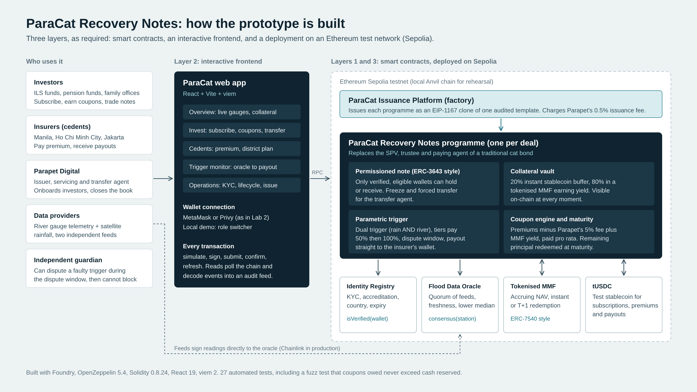

# ParaCat Recovery Notes: prototype

A working, full-stack prototype of **ParaCat Recovery Notes**, Parapet Digital's tokenised parametric
flood catastrophe bond for Asian insurers (BF3124 group project, prototype deliverable).

> **Instructors:** [SETUP.md](SETUP.md) has step-by-step instructions for installing the tools,
> running the tests and launching the demo on your own computer.

It covers the three layers the brief asks for:

| Layer | What is in this repo |
| --- | --- |
| **1. Smart contracts** (on-chain logic) | Six Solidity contracts in `contracts/src`, built and tested with Foundry and OpenZeppelin 5.4, the same stack as Lab 2. 27 automated tests. |
| **2. Interactive frontend** | A React + Vite + viem app in `frontend/` with five views: Overview, Invest, Cedents, Trigger monitor, Operations. Connects with MetaMask, Privy (as in Lab 2) or built-in demo accounts. |
| **3. Deployed on a blockchain** | One-command deployment to **Sepolia** (with Etherscan source verification) or a local **Anvil** chain. The deploy script writes all addresses into the frontend automatically. |



---

## What the prototype demonstrates

| Problem with traditional cat bonds | How ParaCat solves it on-chain | Where in the code |
| --- | --- | --- |
| Every deal needs a new SPV and bespoke legal and technical structuring, so small Asian deals are uneconomic | Each programme is an **EIP-1167 clone of one audited template**; a new deal only supplies parameters | `ParaCatFactory.createProgramme` |
| Collateral sits idle in a trust; investors see it in monthly statements | **Collateral vault**: 20% instant stablecoin buffer, 80% in a **yield-bearing tokenised MMF**, visible on-chain at all times | `closeSubscription`, `TokenisedMMF` |
| Indemnity payouts take 12–24 months of loss adjustment | **Parametric dual trigger** (rainfall AND river level), **tiered** 50% / 100%, paid **straight to the insurer's wallet** | `checkTrigger`, `executePayout` |
| Flood has high basis risk; one bad sensor could trigger a payout | **Two independent feeds, quorum, freshness check, lower median**, plus a **dispute window** for an independent guardian | `FloodOracle.consensus`, `disputeTrigger` |
| Fund redemption is T+1, but insurers need cash on day one | **Two-tranche payout**: buffer pays instantly, the rest follows when the fund settles | `executePayout`, `settlePayout` |
| Notes are 144A placements held through custodians; transfers are slow | **Permissioned security token (ERC-3643 style)**: only KYC'd, eligible wallets can hold or receive; freeze and forced transfer for the transfer agent | `_update`, `canTransfer`, `IdentityRegistry` |
| Coupon and premium flows are manual | **Coupon engine**: premiums (minus Parapet's fee) and MMF yield are paid pro rata, claimable any time | `payPremium`, `distributeCollateralYield`, `claimCoupon` |
| Who gets the money after a flood? | Payout **ends at the insurer's wallet**. The insurer's pre-agreed **district split is published on-chain** for transparency; the insurer distributes it itself | `setAllocationPlan`, `RecoveryAllocation` event |

Business model in code: a **0.5% issuance fee** on each programme (factory) and a **5% servicing fee** on every premium (programme), both paid to the Parapet treasury.

---

## Quick start: run the full demo locally (about 10 minutes the first time)

You need **Node.js 22.12+**, **Git** and **Foundry** (`forge`, `anvil`). Install Foundry from
<https://getfoundry.sh>; Windows users should use WSL, as in Lab 2.

**Terminal 1: start a local blockchain**

```sh
anvil --block-time 1
```

**Terminal 2: compile, test and deploy the contracts**

```sh
cd contracts
forge test                     # 27 tests should pass
forge script script/Deploy.s.sol:Deploy \
  --rpc-url http://127.0.0.1:8545 \
  --private-key 0xac0974bec39a17e36ba4a6b4d238ff944bacb478cbed5efcae784d7bf4f2ff80 \
  --broadcast
```

That key is Anvil's public test key #0 (the same one Lab 2 uses). The script deploys everything, issues the
first US$20m programme, onboards the demo investors and insurers, and seeds US$12m of subscriptions.

**Terminal 3: start the app**

```sh
cd frontend
npm ci
npm run dev
```

Open <http://localhost:5174>. On the local chain the app uses built-in demo accounts: pick the account from the **Account** menu in the sidebar (Parapet Operations, an investor, an insurer, an oracle feed or the guardian).
No MetaMask needed. Time controls let you skip the dispute window and fund settlement.

To reset everything, stop Anvil, start it again and rerun the deploy command.

---

## Deploy to Sepolia (the "deployed on a blockchain environment" layer)

1. **Wallet and test ETH.** Use a disposable MetaMask account. Get about **0.15 Sepolia ETH** from a faucet
   (Google Cloud Web3 faucet, Alchemy or the one given in class). The deployment uses roughly 21 million gas.
2. **RPC and Etherscan keys.** Create a free Alchemy app for Sepolia (as in Lab 2) and a free Etherscan API key.
   Copy `contracts/.env.example` to `contracts/.env` and fill in `SEPOLIA_RPC_URL` and `ETHERSCAN_API_KEY`.
3. **Import your key into Foundry's encrypted keystore** (never paste it into a file):

   ```sh
   cast wallet import paracat-deployer --interactive
   ```

4. **Deploy and verify:**

   ```sh
   cd contracts
   forge script script/Deploy.s.sol:Deploy --rpc-url sepolia \
     --account paracat-deployer --sender YOUR_WALLET_ADDRESS --broadcast --verify --slow
   ```

   `--slow` waits for each transaction to confirm before sending the next (the seed investors need their gas
   money to land first), so allow 10–15 minutes.

   This writes `frontend/src/deployments/11155111.json`. On a public testnet **your wallet holds every
   operational role** (Parapet operations, oracle feed, guardian, and the "Harbour Bay ILS Fund" investor), so one
   MetaMask account can run the whole demo. Two seed investors and the three insurer treasuries are throwaway
   demo wallets; the script sends each seed investor 0.004 ETH for gas.

5. **Point the app at Sepolia.** Copy `frontend/.env.example` to `frontend/.env.local`, set
   `VITE_CHAIN_ID=11155111` and your Alchemy URL in `VITE_RPC_URL`, then `npm run dev`. Click **Connect wallet**.
   Every address and transaction links to Sepolia Etherscan.

6. **Optional: host it.** `npm run build` and drag `frontend/dist` into Netlify or Vercel, or connect the repo.
   Remember the RPC URL is visible to browsers; restrict it to your domain in Alchemy.

**Optional Privy login (Lab 2 style):** set `VITE_PRIVY_APP_ID` in `.env.local` and allow your origin in the
Privy dashboard. Without it, the app talks to MetaMask directly.

**Redeploy on the morning of the pitch.** Demo yield runs 1,440 times faster than real time (one minute equals
one day), and oracle readings expire after six hours, so a fresh deployment gives clean numbers.

---

## Project structure

```text
contracts/
  src/
    ParaCatFactory.sol      Issuance platform: clones the programme template, charges the issuance fee
    ParaCatProgramme.sol    The note: permissioned token, collateral vault, trigger, payouts, coupons, maturity
    IdentityRegistry.sol    KYC / accreditation / jurisdiction registry (ERC-3643 style)
    FloodOracle.sol         Multi-source hazard data with quorum, freshness and lower-median consensus
    TokenisedMMF.sol        Demo tokenised government MMF: accruing NAV, instant and T+1 redemption
    MockUSDC.sol            Test stablecoin with a faucet
  test/ParaCat.t.sol        27 tests: lifecycle, compliance, oracle safety, payouts, maturity, fuzzing
  script/Deploy.s.sol       Deploys, configures and seeds; writes addresses into the frontend
  lib/                      Vendored OpenZeppelin 5.4.0 and forge-std (same as Lab 2)
frontend/
  src/state/                Wallet modes (demo / MetaMask / Privy), chain polling, transaction runner
  src/views/                Overview, Invest, Cedents, Trigger monitor, Operations
  src/components/          Sidebar, exposure map, river staff gauges, event log
  src/lib/seaMap.js         Pre-computed map of Southeast Asia (Natural Earth, public domain); no map service needed
  src/deployments/          Written by the deploy script, one JSON per chain
docs/
  DEMO_SCRIPT.md            Five-minute, click-by-click pitch demo with talking points
  TECH_QA.md                Likely technical questions and answers for the 15-minute Q&A
  architecture.png / .svg   Slide-ready architecture diagram
```

## Run the tests

```sh
cd contracts
forge test -vv
```

What they cover: issuance and fees; template re-initialisation protection; eligibility, minimum and cap on
subscription; expired KYC; collateral split; transfer restrictions, freezing, forced transfer and restricted
countries; pro-rata coupons after the servicing fee; coupons following transfers; collateral yield; oracle quorum;
dual trigger; a faulty feed being ignored; stale readings; two-tranche tier-2 payout and settlement; tier-1 then
tier-2 escalation; guardian dispute rules; pause not blocking a confirmed payout; events after the risk period;
allocation plan rules; maturity with and without losses; and a fuzz test that coupons owed never exceed the cash
reserved for them.

## What is simulated (say this if asked)

- **tUSDC** stands in for USDC or a tokenised deposit, and has a public faucet.
- **The tokenised MMF** is a mock of a fund like BUIDL or a tokenised SGS fund. It mints its own interest and its
  yield clock is accelerated for the demo.
- **Oracle feeds** are wallets that sign readings. In production these would be licensed data providers delivered
  through an oracle network such as Chainlink, with the same quorum and lower-median rule.
- **Short timers**: the dispute window is 60 seconds (72 hours in production) and fund settlement 90 seconds (T+1).
- **Identity data**: display names sit on-chain for the demo only; production would use ONCHAINID claims with no
  personal data on-chain.
- **Legal wrapper**: the notes would be issued by a Singapore SPRV (ideally a protected cell) under MAS's ILS
  framework; the token records ownership and executes payments, it does not replace the reinsurance contract.
- Thresholds, insurers and investors are illustrative. Contracts are unaudited and for test networks only.

## Troubleshooting

| Symptom | Fix |
| --- | --- |
| "Can't reach the chain" | Start `anvil --block-time 1` (local) or check `VITE_RPC_URL` (Sepolia), then reload. |
| "No deployment found" | Run the deploy script; it writes `frontend/src/deployments/<chainId>.json`. |
| Trigger check says not enough readings | Readings expire after six hours or after a time skip. Use a scenario on the Trigger monitor to report fresh ones. |
| "Not an eligible, verified investor" | Onboard the wallet in Operations (identity registry). Insurers are deliberately not eligible to hold notes. |
| MetaMask shows the wrong nonce after restarting Anvil | MetaMask > Settings > Advanced > Clear activity tab data. |
| `forge` can't download the compiler | It needs internet once to fetch Solidity 0.8.24; or install `solc` 0.8.24 and pass `--use`. |
| Contract changes not showing in the app | `forge build` then `npm run sync-abi` in `frontend/`. |
